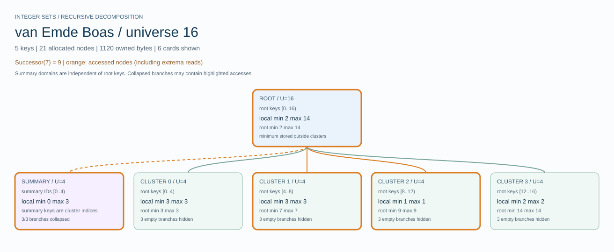

# van-emde-boas-successor

A dependency-free Rust experiment in **universe-oriented integer search**.
Implements a classic van Emde Boas (vEB) set, checks it against `BTreeSet`,
measures its recursive work and memory, and draws its cluster hierarchy as SVG.



[Full universe-16 hierarchy](docs/images/universe-16.svg) ·
[Larger universe with collapsed branches](docs/images/universe-65536.svg) ·
[Algorithm and invariants](docs/algorithm.md) ·
[Experiment method and recorded results](docs/experiments.md)

## Run it

Requires a Rust toolchain supporting edition 2024 and let chains (Rust 1.88+).
Validated here with Rust 1.97.1 on Windows x86-64. No external crates,
services, browser dependencies, or GitHub workflows are needed to build or run.

```sh
cargo test --release
cargo run --release -- verify
cargo run --release -- bench --output output/queries.csv
cargo run --release -- bench --workload mixed --output output/mixed.csv
cargo run --release -- render --successor 7 --output output/tree.svg
```

`verify` defaults to **10,000 deterministic mixed operations per universe**,
seed 42. `bench` defaults to all three universes, initial occupancies of
1%, 50%, and 90%, 10,000 operations, seven repetitions, and a read-only query
workload. `render` defaults to universe 16 and keys `2,3,7,9,14`.

```sh
cargo run --release -- verify --universe 65536 --operations 10000 --seed 42
cargo run --release -- bench --universe 65536 --occupancy 50 --repeats 7
cargo run --release -- render --universe 16 --keys 2,3,7,9,14 --show-empty --successor 7
cargo run --release -- render --universe 65536 --keys 0,255,256,4096,65535 --depth 2 --predecessor 4096
cargo run --release -- --help
```

Open the SVG in a browser or vector viewer and zoom to inspect a wide diagram.
Rendering has a default cap of 200 cards; `--depth` and `--max-nodes` control
expansion, and `--show-empty` includes empty branches. Hidden and collapsed
branches are labelled. Purple dashed edges lead to summaries; orange outlines
mark query accesses, including cached-extremum reads. Summary keys are cluster
indices, so their coordinates are separate from root integer keys.

## Library API

```rust
use veb_successor::{VebSet, SvgOptions, Query};

let mut set = VebSet::new(256).unwrap();
for key in [3, 7, 42] { assert!(set.insert(key).unwrap()); }

assert_eq!(set.minimum(), Some(3));
assert_eq!(set.maximum(), Some(42));
assert_eq!(set.successor(7).unwrap(), Some(42));
assert_eq!(set.predecessor(7).unwrap(), Some(3));
assert!(set.contains(7).unwrap());
assert!(!set.insert(7).unwrap()); // already present
assert!(set.remove(7).unwrap());
assert_eq!(set.to_vec(), [3, 42]);
set.validate().unwrap();

set.reset_metrics();
set.successor(3).unwrap();
println!("{:?}", set.metrics());
println!("{:?}", set.storage());
let svg = set.to_svg(SvgOptions {
    query: Some(Query::Successor(3)),
    ..SvgOptions::default()
}).unwrap();
assert!(svg.contains("Successor(3) = 42"));
```

Supported universe sizes are **16, 256, and 65,536**, with keys in `0..U`.
Keys and universe sizes use `u32`; 65,536 is a size, not a valid key in the
largest universe. All key-taking operations reject out-of-range input.
Predecessor/successor are **strict**; they accept absent keys too, and return
`None` when no answer exists. Inserting duplicates and removing absent keys
return `false`. Empty-set extrema return `None`.

## Complexity and storage

| Operation | Worst-case time |
|---|---|
| Construct the eager hierarchy | O(U) |
| Insert, remove, contains, predecessor, successor | O(log log U) |
| Minimum, maximum, length, emptiness | O(1) |
| Inspect storage or validate all invariants | O(U) |
| Collect ordered keys | O(U) upper bound |

All recursive summaries and clusters are allocated during construction. The
root minimum is stored outside its clusters; summaries track nonempty clusters.
An update may enter both a cluster and its summary, but one of those updates
is constant-time at an empty/singleton node. Membership prechecks make public
insert/remove safe for duplicate/absent keys without changing the asymptotic
bound.

| Universe | Allocated nodes | Owned bytes on this x86-64 build | Maximum recursion depth |
|---|---:|---:|---:|
| 16 | 21 | 1,120 | 2 |
| 256 | 358 | 17,296 | 3 |
| 65,536 | 92,007 | 4,416,448 | 4 |

Depth counts edges below the root. Owned bytes include the set struct, nodes,
and heap buffers, including summaries. They exclude allocator bookkeeping,
rounding, process overhead, workload arrays, and SVG output. Layout bytes are
platform/compiler dependent. Eager node counts and owned bytes do not shrink
when keys are deleted.

## Correctness and measurements

The suite checks:

- Every result of 10,000 deterministic mixed operations per universe against
  `BTreeSet`, with full contents and recursive invariants after every attempted
  mutation. Failure messages include the seed and zero-based operation index.
- Every one of the 65,536 subsets of universe 16, every key query, and every
  possible single-key insert/remove from those states.
- Full-universe fill/drain sequences in both directions, boundaries, invalid
  keys, duplicate insertion, missing deletion, and empty/singleton transitions.
- Counter-enabled/disabled equivalence, eager storage accounting, all small
  query-trace states, bounded SVG rendering, and CLI success/error paths.

Counters record public calls by operation, node visits, recursive calls,
indexed cluster accesses, summary accesses, and maximum depth. Internal
membership checks contribute to node/recursion counters without incrementing
the public `contains` count. Invalid-key attempts count as public calls.
`to_vec`, `validate`, `storage`, and `to_svg` do not change counters.
Counters are enabled by default; `set_metrics_enabled(false)` disables updates
without clearing existing values, and `reset_metrics()` clears them.

Benchmarks replay identical pre-generated traces against both implementations.
Exact result verification and metrics collection happen before timing. Timed
vEB runs disable recursive counter updates. Setup (including prefill), query
batches, validation, and rendering are kept separate; both timed loops include
the same driver dispatch/checksum overhead. CSV records setup median, batch
min/median/max, median ns/op, platform/profile, and the untimed counters.
Blank `BTreeSet` internal-storage/counter fields mean **unmeasured**.

The saved results show that the winner depends on workload. For example,
at U=65,536 and 50% initial occupancy, this run measured 31.66 vs 45.67 ns/op
for queries (vEB vs `BTreeSet`), but 64.49 vs 50.12 ns/op for mixed operations.
These short, local measurements do not establish a general speed advantage
or an empirical asymptotic bound. See [the experiment notes](docs/experiments.md).

## Development

```sh
cargo fmt --check
cargo clippy --all-targets -- -D warnings
cargo test --release
cargo doc --no-deps
```

`cargo test` also works; the exhaustive checks run faster in release mode.
Source modules separate the core (`veb`), instrumentation (`metrics`), oracle
and generator (`workload`), timing (`benchmark`), rendering (`svg`), and CLI.

## References

- [MIT 6.046J, Lecture 4: van Emde Boas trees](https://ocw.mit.edu/courses/6-046j-design-and-analysis-of-algorithms-spring-2015/resources/lecture-4-divide-conquer-van-emde-boas-trees/)
  — recursive decomposition, minimum separation, and the recurrence.
- [The Ledger: Van Emde Boas Tree](https://ledger.khushal.net/chapters/van-emde-boas-tree/)
  — the illustrated topic that inspired this project.

Possible follow-up experiments: sparse allocation, bitmap base cases, and a
bitset baseline. The MVP deliberately preserves the classic eager hierarchy
so the memory cost remains visible.
